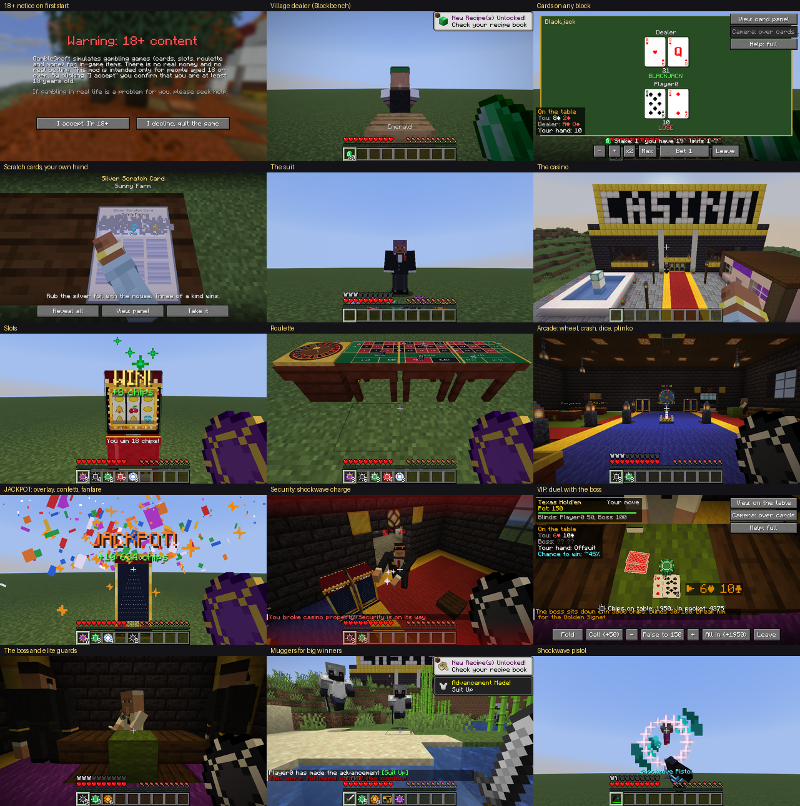
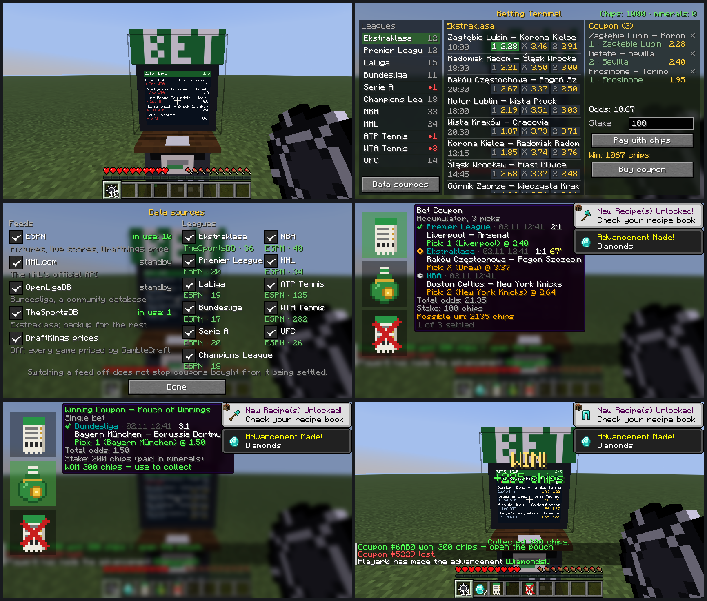

# GambleCraft

A casino mod for Minecraft 26.3 (Fabric). Card dealers in villages, village scratch cards, a suit-only casino with
slots, roulette, plinko, the wheel of fortune, crash, dice and card tables, casino security, and the casino's people
(the loan shark, the pickpocket, the boss's VIP duel, muggers for big winners).

Everything is played for in-game items; there is no real money anywhere. The first start shows an 18+ notice.



## Sportsbook add-on

`sportsbook/` is a separate mod on top of GambleCraft: betting terminals with real fixtures, live scores and results
(Ekstraklasa, Premier League, LaLiga, Bundesliga, Serie A, Champions League, NBA, NHL, ATP/WTA tennis, UFC) from
public sports feeds (ESPN, NHL.com, OpenLigaDB, TheSportsDB), each of which can be switched on or off in the game.
Coupons are bought for chips or minerals and settle themselves on the real results; a won coupon turns into a pouch
of chips.



## Building

Java 25 (set `org.gradle.java.home` in `gradle.properties` to your JDK, or remove the line), then:

```
./gradlew build
```

- `build/libs/gamblecraft-0.1.0.jar` — the mod
- `sportsbook/build/libs/gamblecraft-sportsbook-0.1.0.jar` — the add-on (needs the mod)

Both need Fabric Loader 0.20.1+ and Fabric API 0.165.0+26.3. `./gradlew build` also runs the unit tests and the
game tests; `runClientGameTest` (per project) plays the games in front of the camera and saves screenshots.

## Docs

- [docs/GUIDE.md](docs/GUIDE.md) — how to play, server settings
- [docs/API_26_3.md](docs/API_26_3.md) — notes on the Minecraft 26.3 / Fabric API learned while building it
- `tools/` — Python generators for textures, sounds, structures and Blockbench models; `blockbench/` — the models

The sports data belongs to the feeds it comes from; GambleCraft is not affiliated with any of them or with any
bookmaker.
